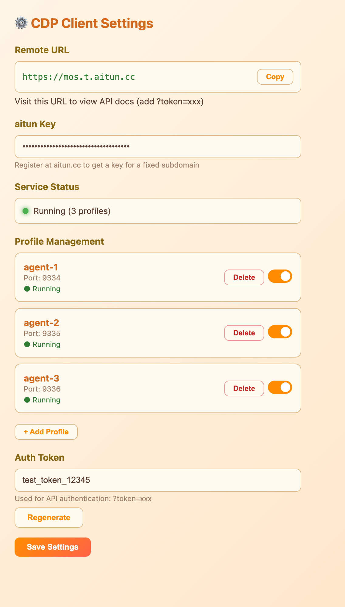
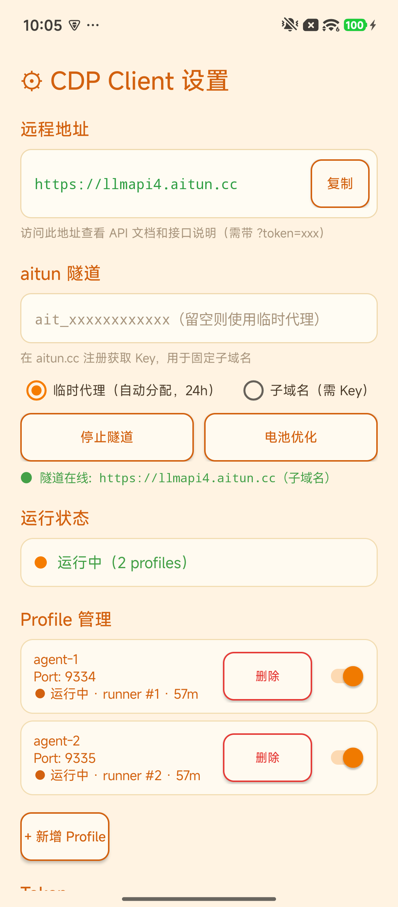
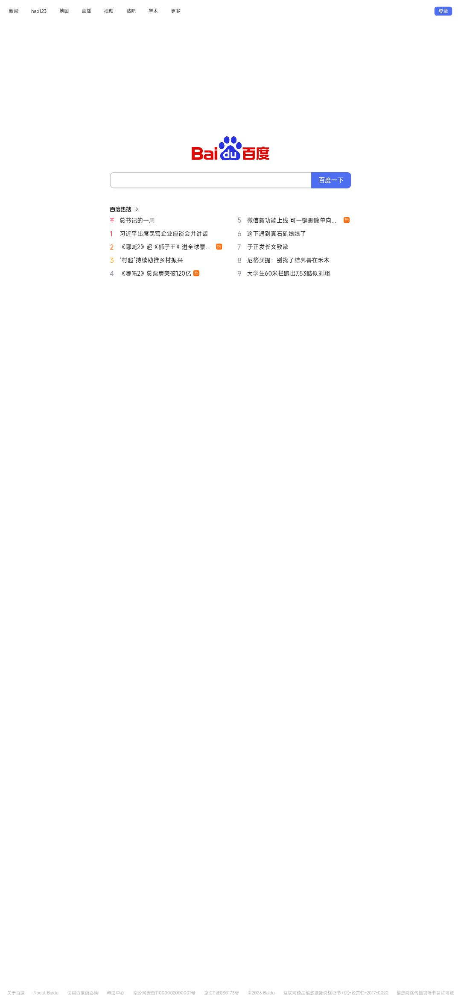

# SamCDP

Remote Chrome automation for AI agents. Expose local Chrome browsers as public HTTPS endpoints via [aitun](https://aitun.cc) tunnel, enabling remote AI agents to control and automate Chrome from anywhere.

[中文文档](README_cn.md)

---

## Features

- **Multi-Profile Chrome Management** — Run multiple isolated Chrome instances simultaneously, each with its own login session, cookies, and debugging port
- **One Public URL for All Profiles** — Single tunnel serves all Chrome instances via path routing (`/agent-1/json/list`, `/agent-2/json/list`, etc.)
- **RESTful Management API** — Start/stop Chrome, list/open/close tabs, proxy raw CDP commands — all via HTTP
- **Android Version (APK)** — Turn an Android phone into a remote WebView automation endpoint with the same REST API ([Releases](https://github.com/samaidev/samcdp/releases))
- **Login Persistence** — Chrome user-data-dir preserves cookies and sessions across restarts; no need to re-login after restart
- **Auto-Cleanup** — Automatically kills stale Chrome processes on startup to prevent window accumulation
- **Duration-Based Auto-Shutdown** — Start Chrome with a time limit; auto-closes when expired
- **Tab TTL Enforcement (close_after)** — Tabs opened via the API require an explicit `close_after` lifetime (seconds) and are auto-closed when it expires, so agents can no longer leak tabs and exhaust memory; tabs opened manually from the phone UI default to 1 hour
- **System Tray Integration** — Native tray icon with run/stop/settings menu
- **Cross-Platform** — Windows, Linux, macOS, Android

## Screenshot



## Quick Install

### Linux / macOS

```bash
curl -fsSL https://raw.githubusercontent.com/samaidev/samcdp/main/install.sh | bash
```

### Windows (PowerShell)

```powershell
irm https://raw.githubusercontent.com/samaidev/samcdp/main/install.ps1 | iex
```

> macOS note: The system tray requires CGO. Run `CGO_ENABLED=1 go build` if building from source on macOS.

## Usage

### 1. Get an aitun Key

Register at [aitun.cc](https://aitun.cc), verify your email, and register a subdomain to get a key (`ait_xxxx`).

### 2. Configure

Launch SamCDP — a system tray icon will appear. Right-click the tray icon and select **Settings** to open the settings page:

- Enter your **aitun Key**
- Manage **Profiles** (add/remove/toggle)
- View your **Remote URL** and **Auth Token**

Alternatively, edit the config file directly:

- **Windows:** `%APPDATA%\cdpclient\config.json`
- **Linux:** `~/.config/cdpclient/config.json`
- **macOS:** `~/Library/Application Support/cdpclient/config.json`

```json
{
  "aitun_key": "ait_your_key_here",
  "auth_token": "auto_generated",
  "lang": "en",
  "profiles": [
    {"name": "agent-1", "port": 9334, "enabled": true},
    {"name": "agent-2", "port": 9335, "enabled": true},
    {"name": "agent-3", "port": 9336, "enabled": true}
  ]
}
```

### 3. Start the Service

Click **Run** in the tray menu, or SamCDP auto-starts on launch. The tunnel URL will appear in the tray menu (e.g. `https://mos.t.aitun.cc`).

### 4. Use the API

All endpoints require authentication via `?token=YOUR_TOKEN` or `Authorization: Bearer YOUR_TOKEN`.

| Method | Endpoint | Description |
|--------|----------|-------------|
| `GET` | `/?token=xxx` | API docs page |
| `GET` | `/api/profiles?token=xxx` | List all profiles |
| `POST` | `/api/profiles/<name>/start?token=xxx&duration=MINUTES` | Start Chrome (duration required) |
| `POST` | `/api/profiles/<name>/stop?token=xxx` | Stop Chrome |
| `GET` | `/api/profiles/<name>/tabs?token=xxx` | List browser tabs |
| `POST` | `/api/profiles/<name>/tabs/new?url=URL&close_after=SECONDS&token=xxx` | Open a new tab (**`close_after` required**: auto-close after N seconds, 1..604800) |
| `DELETE` | `/api/profiles/<name>/tabs/<id>?token=xxx` | Close a tab |
| — | `/<profile>/json/*` | Raw CDP protocol passthrough |

#### Example: Start Chrome and Automate

```bash
# Start Chrome for agent-1 (30 minute limit)
curl -X POST "https://YOUR_URL/api/profiles/agent-1/start?token=YOUR_TOKEN&duration=30"

# Open DeepSeek (tab auto-closes after 3600s = 1 hour; close_after is REQUIRED)
curl -X POST "https://YOUR_URL/api/profiles/agent-1/tabs/new?url=https://chat.deepseek.com&close_after=3600&token=YOUR_TOKEN"

# List tabs
curl "https://YOUR_URL/api/profiles/agent-1/tabs?token=YOUR_TOKEN"

# Connect via CDP WebSocket
wss://YOUR_URL/agent-1/json/version
```

#### Python Example

```python
import requests

BASE = "https://YOUR_URL"
TOKEN = "YOUR_TOKEN"

# Start Chrome (30 min)
requests.post(f"{BASE}/api/profiles/agent-1/start", params={"token": TOKEN, "duration": 30})

# Open a tab — close_after (seconds) is REQUIRED; the tab auto-closes when it expires
resp = requests.post(f"{BASE}/api/profiles/agent-1/tabs/new",
                     params={"token": TOKEN, "url": "https://chat.deepseek.com", "close_after": 3600})
print(resp.json())

# List tabs
resp = requests.get(f"{BASE}/api/profiles/agent-1/tabs", params={"token": TOKEN})
print(resp.json())
```

## Android Version (APK)

**SamCDP-Android** turns an Android phone into a remote WebView automation endpoint. The on-device REST API is 1:1 compatible with the desktop version — profiles map to isolated headless WebView sessions instead of Chrome instances.




### Highlights (vs desktop)

- **aitun tunnel built-in, dual mode** — 临时代理 (free auto-assigned URL, 24h) or 子域名 (registered subdomain with your `ait_` key). The tunnel client (`libaitunclient.so`, same one SamDocker uses) is bundled and executed from `nativeLibraryDir`; the app resolves `aitun.cc` via the Android resolver and passes `-s IP:6639` since Go static binaries can't read Android DNS
- **True multi-cookie-jar profiles** — each started profile runs in its OWN Android process (`:cdp1`…`:cdp6`) with its own WebView data directory suffix, so cookie jars are fully isolated per profile; cookies persist to per-profile storage on stop and are restored on start
- **Restart memory (v1.4.1)** — profiles started from the phone switch (or `duration=0`) are saved as auto-start and ALL of them are re-activated automatically the next time the app opens; with nothing saved (first launch), the first profile is activated by default; API starts with `duration>0` stay temporary and are not restored; orphan runner processes from a previous session are detected and cleaned up
- **Desktop-parity settings UI** — same warm cream/orange design and sections as the desktop settings page; desktop logo (orange C) as launcher icon
- **Battery optimization button** (samdocker style) — request the system to exempt the app from Doze so the tunnel/service survives in background
- **Remote profile management** — `POST /api/profiles/add?name=x`, `DELETE /api/profiles/<name>`

### Install

Download `SamCDP-android-vX.Y.Z-debug.apk` from the [Releases page](https://github.com/samaidev/samcdp/releases) (requires Android 8.0+ / API 26), sideload it (allow "install unknown apps"), open the app and tap **Run**. The app auto-starts the API server and shows its URL + token on screen.

> MIUI/HyperOS note: enable Developer options → "Install via USB" when installing over `adb`.

### Android API surface

Identical to desktop, plus mobile-specific extras:

| Method | Endpoint | Description |
|--------|----------|-------------|
| `GET` | `/api/health?token=xxx` | Health probe |
| `GET` | `/api/status?token=xxx` | Server status (ip/port/tunnel/running profiles) |
| `GET` | `/api/tunnel?token=xxx` | aitun tunnel state |
| `POST` | `/api/tunnel/start?mode=temp&token=xxx` | Start temporary tunnel (free auto URL) |
| `POST` | `/api/tunnel/start?mode=subdomain&key=ait_xxx&token=xxx` | Start subdomain tunnel |
| `POST` | `/api/tunnel/stop?token=xxx` | Stop tunnel |
| `GET` | `/api/profiles?token=xxx` | List all profiles |
| `POST` | `/api/profiles/add?name=x&token=xxx` | Add profile (max 6, one process each) |
| `DELETE` | `/api/profiles/<name>?token=xxx` | Remove profile |
| `POST` | `/api/profiles/<name>/start?token=xxx&duration=MIN` | Start profile in isolated process |
| `POST` | `/api/profiles/<name>/stop?token=xxx` | Stop profile (cookies persisted) |
| `GET` | `/api/profiles/<name>/tabs?token=xxx` | List tabs |
| `POST` | `/api/profiles/<name>/tabs/new?url=URL&close_after=SEC&ua=AGENT&token=xxx` | Open tab (**`close_after` required** seconds until auto-close; `ua` optional) |
| `DELETE` | `/api/profiles/<name>/tabs/<id>?token=xxx` | Close a tab |
| `GET` | `/api/profiles/<name>/tabs/<id>/screenshot?token=xxx` | PNG screenshot of the tab |
| `POST` | `/api/profiles/<name>/tabs/<id>/eval?token=xxx` | Run JS in the tab, body `{"js":"..."}` |
| `GET` | `/<profile>/json/version` · `/<profile>/json/list` | CDP-style passthrough |
| `GET` | `/api/downloads?token=xxx` | Downloads across ALL profiles (running proxied live, stopped read from disk) |
| `GET` | `/api/profiles/<name>/downloads?token=xxx` | List this profile's WebView-downloaded files |
| `GET` | `/api/profiles/<name>/downloads/<id>/file?token=xxx` | Pull a downloaded file (raw bytes) |
| `DELETE` | `/api/profiles/<name>/downloads/<id>?token=xxx` | Delete a downloaded file |
| `POST` | `/api/profiles/<name>/downloads/<id>/upload?tab=ID&selector=CSS&token=xxx` | Hand a downloaded file to a page's `<input type=file>` (attach & upload) |

Notes:
- **`close_after` is REQUIRED on `tabs/new`** — integer seconds (1..604800) until the tab is auto-destroyed and its memory reclaimed, e.g. `close_after=3600` = 1 hour. Requests without it get HTTP 400 with a self-explanatory error. This exists so agents must declare a tab's lifetime instead of leaking tabs; tabs opened by a human on the phone UI (➕ button / 显示WebView / page popups) default to 1 hour. `GET /tabs` returns `auto_close_in_s` (remaining seconds) per tab
- **Downloads (v1.4.2)** — files downloaded inside any WebView (direct links, `blob:` exports, `data:` URLs) are captured automatically into that profile's private storage (nothing touches the phone's public Downloads folder). List with `GET .../downloads` (fields: id, name, size, state, url), pull bytes with `GET .../downloads/<id>/file`, delete with `DELETE .../downloads/<id>`. To use a file as an **attachment** on a website (e.g. upload to site B after exporting from site A): open the target tab, then `POST .../downloads/<id>/upload?tab=<tabId>&selector=<css>` — the file is handed to the page's first matching `<input type=file>` and the page continues its own upload flow (submit the form via `/eval` if it doesn't auto-submit). The tab must be alive (remember `close_after`) and the selector must point at a real file input on the CURRENT page. The phone UI's WebView toolbar has a ⬇ button listing these files (tap title to open, 🗑 to delete)
- Tabs render headless (1080x2340) with a desktop Chrome User-Agent by default; pass `&ua=...` to override
- Non-http(s) navigations (deep links like `baiduboxapp://`) are blocked to prevent hijacks
- `duration` triggers auto-stop, mirroring desktop behavior

### Build the APK from source

```bash
# dependency-free toolchain: build-tools 34 (aapt2/d8/apksigner) + platform-34 + ECJ
SDK_DIR=/path/to/sdk android/build.sh
# → android/build/SamCDP-android-vX.Y.Z-debug.apk
```

See [android/README.md](android/README.md) for details.

## Download Pre-built Binaries

Download from the [Releases page](https://github.com/samaidev/samcdp/releases) — every desktop artifact bundles the aitun tunnel client (no separate download needed since v1.4.7):

| Platform | File |
|----------|------|
| Windows | `samcdp-desktop-v{VER}-windows-amd64.exe` |
| Linux | `samcdp-desktop-v{VER}-linux-amd64` |
| macOS (Intel) | `samcdp-desktop-v{VER}-darwin-amd64` |
| macOS (Apple Silicon) | `samcdp-desktop-v{VER}-darwin-arm64` |
| Android | `SamCDP-android-v{VER}.apk` |

Each release also ships stable-name aliases (`samcdp-windows-amd64.exe`, `samcdp-linux-amd64`, `samcdp-darwin-amd64`, `SamCDP-android.apk`) for scripted installs.

## CI / Releases

GitHub Actions automates builds and releases:

- **CI** (`.github/workflows/ci.yml`) — runs `go vet` + build smoke tests on every push/PR to `main`.
- **Release** (`.github/workflows/release.yml`) — pushing an annotated tag `v*` builds all artifacts (Windows/Linux/darwin desktop + Android APK) and publishes a GitHub Release automatically:

  ```bash
  git tag -a v1.4.10 -m "release notes here"
  git push origin v1.4.10
  ```

  The tag annotation becomes the release notes (`--notes-from-tag`). `workflow_dispatch` on the Actions page does a build-only dry run. The Android build signs with the committed `android/samcdp-debug.keystore` so upgrades never break signature verification.

## Build from Source

```bash
# Windows
go build -ldflags "-H windowsgui" -o cdpclient.exe .

# Linux
CGO_ENABLED=0 go build -o cdpclient .

# macOS (requires CGO for system tray)
CGO_ENABLED=1 go build -o cdpclient .
```

## License

MIT
