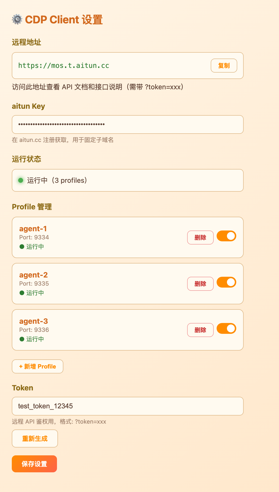

# SamCDP

远程 Chrome 自动化工具，专为 AI 智能体设计。通过 [aitun](https://aitun.cc) 隧道将本地 Chrome 浏览器暴露为公网 HTTPS 地址，让远程智能体可以随时控制和自动化操作 Chrome。

[English README](README.md)

---

## 功能特性

- **多 Profile Chrome 管理** — 同时运行多个独立 Chrome 实例，各自拥有独立的登录状态、Cookie 和调试端口
- **一个公网地址管所有 Profile** — 单条隧道通过路径路由服务所有 Chrome 实例（`/agent-1/json/list`、`/agent-2/json/list` 等）
- **RESTful 管理 API** — 通过 HTTP 启动/停止 Chrome、列出/打开/关闭标签页、透传原生 CDP 协议
- **Android 版本（APK）** — 把安卓手机变成远程 WebView 自动化端点，REST API 与桌面版 1:1 兼容（见 [Releases](https://github.com/samaidev/samcdp/releases)）
- **登录状态持久化** — Chrome user-data-dir 保留 Cookie 和 session，重启后无需重新登录
- **自动清理** — 启动时自动杀掉残留 Chrome 进程，防止窗口堆积
- **超时自动关闭** — 启动 Chrome 时可指定运行时长（分钟），到期自动关闭
- **系统托盘集成** — 原生托盘图标，支持运行/停止/设置菜单
- **跨平台** — 支持 Windows、Linux、macOS、Android

## 截图



## 一键安装

### Linux / macOS

```bash
curl -fsSL https://raw.githubusercontent.com/samaidev/samcdp/main/install.sh | bash
```

### Windows（PowerShell）

```powershell
irm https://raw.githubusercontent.com/samaidev/samcdp/main/install.ps1 | iex
```

> macOS 注意：系统托盘需要 CGO 编译。从源码编译时请使用 `CGO_ENABLED=1 go build`。

## 使用方法

### 1. 获取 aitun 密钥

在 [aitun.cc](https://aitun.cc) 注册账号，验证邮箱后注册子域名，获取密钥（`ait_xxxx`）。

### 2. 配置

启动 SamCDP，系统托盘会出现图标。右键点击托盘图标，选择**设置**打开设置页面：

- 填入 **aitun Key**
- 管理 **Profile**（新增/删除/启用切换）
- 查看你的**远程地址**和**鉴权 Token**

也可以直接编辑配置文件：

- **Windows:** `%APPDATA%\cdpclient\config.json`
- **Linux:** `~/.config/cdpclient/config.json`
- **macOS:** `~/Library/Application Support/cdpclient/config.json`

```json
{
  "aitun_key": "ait_你的密钥",
  "auth_token": "自动生成",
  "lang": "zh",
  "profiles": [
    {"name": "agent-1", "port": 9334, "enabled": true},
    {"name": "agent-2", "port": 9335, "enabled": true},
    {"name": "agent-3", "port": 9336, "enabled": true}
  ]
}
```

### 3. 启动服务

在托盘菜单点击**运行**，或启动后自动运行。隧道地址会显示在托盘菜单中（如 `https://mos.t.aitun.cc`）。

### 4. 调用 API

所有接口需要鉴权：通过 `?token=YOUR_TOKEN` 参数或 `Authorization: Bearer YOUR_TOKEN` 请求头。

| 方法 | 路径 | 说明 |
|------|------|------|
| `GET` | `/?token=xxx` | API 文档页面 |
| `GET` | `/api/profiles?token=xxx` | 列出所有 profile |
| `POST` | `/api/profiles/<name>/start?token=xxx&duration=分钟` | 启动 Chrome（duration 必填） |
| `POST` | `/api/profiles/<name>/stop?token=xxx` | 停止 Chrome |
| `GET` | `/api/profiles/<name>/tabs?token=xxx` | 列出标签页 |
| `POST` | `/api/profiles/<name>/tabs/new?url=URL&token=xxx` | 打开新标签页 |
| `DELETE` | `/api/profiles/<name>/tabs/<id>?token=xxx` | 关闭标签页 |
| — | `/<profile>/json/*` | CDP 原生协议透传 |

#### 示例：启动 Chrome 并自动化操作

```bash
# 启动 agent-1 的 Chrome（30 分钟超时）
curl -X POST "https://你的地址/api/profiles/agent-1/start?token=你的Token&duration=30"

# 打开 DeepSeek
curl -X POST "https://你的地址/api/profiles/agent-1/tabs/new?url=https://chat.deepseek.com&token=你的Token"

# 列出标签页
curl "https://你的地址/api/profiles/agent-1/tabs?token=你的Token"

# 通过 CDP WebSocket 连接
wss://你的地址/agent-1/json/version
```

#### Python 示例

```python
import requests

BASE = "https://你的地址"
TOKEN = "你的Token"

# 启动 Chrome（30 分钟）
requests.post(f"{BASE}/api/profiles/agent-1/start", params={"token": TOKEN, "duration": 30})

# 列出标签页
resp = requests.get(f"{BASE}/api/profiles/agent-1/tabs", params={"token": TOKEN})
print(resp.json())
```

## Android 版本（APK）

**SamCDP-Android** 把安卓手机变成远程 WebView 自动化端点。手机端 REST API 与桌面版 1:1 兼容 —— Profile 对应隔离的 headless WebView 会话（替代桌面版 Chrome 实例）。


### 安装

从 [Releases 页面](https://github.com/samaidev/samcdp/releases) 下载 `SamCDP-android-vX.Y.Z-debug.apk`（需要 Android 8.0+ / API 26），允许"安装未知应用"后侧载安装，打开 App 点击**运行**。App 会自动启动 API 服务器，并在界面上显示访问地址和 Token。

> MIUI/HyperOS 提示：如通过 `adb` 安装，需在开发者选项中开启"USB 安装"。

### 安卓端 API

与桌面版一致，另有移动端专属接口：

| 方法 | 路径 | 说明 |
|------|------|------|
| `GET` | `/api/health?token=xxx` | 健康检查 |
| `GET` | `/api/status?token=xxx` | 服务器状态（ip/port/uptime/运行中的 profile） |
| `GET` | `/api/profiles?token=xxx` | 列出所有 profile |
| `POST` | `/api/profiles/<name>/start?token=xxx&duration=分钟` | 启动 profile（duration 必填） |
| `POST` | `/api/profiles/<name>/stop?token=xxx` | 停止 profile（Cookie 持久化） |
| `GET` | `/api/profiles/<name>/tabs?token=xxx` | 列出标签页 |
| `POST` | `/api/profiles/<name>/tabs/new?url=URL&token=xxx&ua=AGENT` | 打开标签页（headless WebView，`ua` 可选） |
| `DELETE` | `/api/profiles/<name>/tabs/<id>?token=xxx` | 关闭标签页 |
| `GET` | `/api/profiles/<name>/tabs/<id>/screenshot?token=xxx` | 标签页 PNG 截图 |
| `POST` | `/api/profiles/<name>/tabs/<id>/eval?token=xxx` | 在标签页内执行 JS，body `{"js":"..."}` |
| `GET` | `/<profile>/json/version` · `/<profile>/json/list` | CDP 风格透传 |

说明：
- 标签页默认以桌面 Chrome UA 渲染（1080x2340 headless），可用 `&ua=...` 覆盖
- 非 http(s) 跳转（如 `baiduboxapp://` 深链）会被拦截，防止劫持
- Cookie 按 Profile 快照持久化，start 时恢复（登录状态保留）
- `duration` 到期自动关闭，与桌面版一致

### 从源码构建 APK

```bash
# 零依赖工具链：build-tools 34（aapt2/d8/apksigner）+ platform-34 + ECJ
SDK_DIR=/path/to/sdk android/build.sh
# → android/build/SamCDP-android-vX.Y.Z-debug.apk
```

详见 [android/README.md](android/README.md)。

## 下载预编译二进制

从 [Releases 页面](https://github.com/samaidev/samcdp/releases) 下载：

| 平台 | 文件 |
|------|------|
| Windows | `cdpclient-windows-amd64.exe` + `aitun-client-windows-amd64.exe` |
| Linux | `cdpclient-linux-amd64` + `aitun-client-linux-amd64` |
| macOS | `cdpclient-darwin-amd64` + `aitun-client-darwin-amd64` |

将 `aitun-client` 放到 `cdpclient` 同目录下，然后运行 `cdpclient` 即可。

## 从源码编译

```bash
# Windows
go build -ldflags "-H windowsgui" -o cdpclient.exe .

# Linux
CGO_ENABLED=0 go build -o cdpclient .

# macOS（系统托盘需要 CGO）
CGO_ENABLED=1 go build -o cdpclient .
```

## 许可证

MIT
