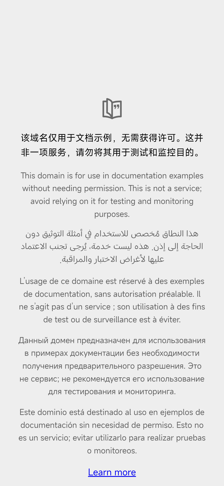

# SamCDP-Android

Android (APK) version of [SamCDP](../README.md) — turn an Android phone into a remote WebView automation endpoint for AI agents. The on-device REST API is 1:1 compatible with the desktop version; profiles map to isolated headless WebView sessions instead of desktop Chrome instances.

## Highlights

- **Desktop-parity REST API** — profiles / start / stop / tabs / CDP-style `json` passthrough, same token auth (`?token=` or `Authorization: Bearer`)
- **Headless WebView engine** — each tab is an off-screen WebView (412x915 portrait phone viewport) with JavaScript + DOM storage enabled; pages really render, so `eval` and `screenshot` work on any site
- **Login persistence** — cookie jars are snapshotted per profile on stop and restored on start
- **Duration auto-stop** — same as desktop: `start?duration=MIN` schedules an automatic shutdown
- **Agent-friendly extras** — `POST .../tabs/<id>/eval` runs JS and returns the result; `GET .../tabs/<id>/screenshot` returns a live PNG
- **Anti-hijack** — non-http(s) navigations (deep links like `baiduboxapp://`) are blocked
- **Desktop UA by default** — far better site compatibility for automation; override per tab with `&ua=`
- **Foreground service** — persistent notification with the server URL and token; survives in background
- **Zero third-party dependencies** — pure Android framework + `org.json`

## Screenshots

| App (terminal-style dark UI) | Headless tab: Baidu | Headless tab: example.com |
|---|---|---|
|  |  |  |

## Install

1. Grab `samcdp-android.apk` from the [Releases page](https://github.com/samaidev/samcdp/releases) (Android 8.0+ / API 26)
2. Sideload: allow "install unknown apps" for your file manager/browser
   - MIUI/HyperOS: also enable Developer options → "Install via USB" if installing over `adb`
3. Open SamCDP → tap **Run** (auto-runs on launch)
4. The status card shows the LAN URL (default `http://<phone-ip>:9334`) and the auth token

Or via adb from a computer:

```bash
adb install -r -t SamCDP-android-v1.0.2-debug.apk
adb shell am start -n cc.samaidev.samcdp/.MainActivity
adb reverse tcp:19334 tcp:9334   # optional: reach the phone API from the computer
curl "http://127.0.0.1:19334/api/health?token=<token>"
```

## Quick tour

```bash
BASE="http://<phone-ip>:9334"; TOKEN="<token from the app>"

# start profile agent-1 for 30 minutes
curl -X POST "$BASE/api/profiles/agent-1/start?token=$TOKEN&duration=30"

# open a tab
curl -X POST "$BASE/api/profiles/agent-1/tabs/new?url=https://example.com&token=$TOKEN"

# read the page title
curl -X POST -H "Content-Type: application/json" \
  -d '{"js":"document.title"}' \
  "$BASE/api/profiles/agent-1/tabs/<tab-id>/eval?token=$TOKEN"
# → {"ok":true,"result":"Example Domain"}

# grab a live screenshot (PNG, 412x915 portrait)
curl -o tab.png "$BASE/api/profiles/agent-1/tabs/<tab-id>/screenshot?token=$TOKEN"

# stop and persist cookies
curl -X POST "$BASE/api/profiles/agent-1/stop?token=$TOKEN"
```

## Build from source

The build is fully dependency-free (no Gradle, no Android Studio):

| Tool | Where | Purpose |
|------|-------|---------|
| `aapt2` | build-tools 34 | compile/link resources + manifest |
| `ecj` (3.36) | single jar, [Maven Central](https://repo1.maven.org/maven2/org/eclipse/jdt/ecj/) | Java compiler (works on a plain JRE) |
| `d8` | build-tools 34 | dex (desugars Java 8 lambdas, minApi 26) |
| `zipalign` + `apksigner` | build-tools 34 | align + sign |

```bash
sdk-root/
  android-14/    # build-tools 34 (upstream folder name: android-14)
  android-34/    # platform 34 (android.jar)
  ecj.jar

SDK_DIR=/path/to/sdk-root ./build.sh
# → build/SamCDP-android-vX.Y.Z-debug.apk
```

`build.sh` keeps a persistent debug keystore at `$SDK_DIR/samcdp-debug.keystore`, so consecutive builds keep the same signing key and can be installed as upgrades.

## Source layout

```
android/
  AndroidManifest.xml
  build.sh                 # one-command build
  res/                     # terminal-style dark UI, launcher icons
  src/cc/samaidev/samcdp/
    MainActivity.java      # status card + profiles + live log
    CdpService.java        # foreground service hosting the API server
    HttpServer.java        # minimal threaded HTTP/1.1 server (no deps)
    Api.java               # REST routing + docs page (desktop-compatible)
    ProfileManager.java    # WebView engine, cookies, timers, eval, screenshots
    Profile.java / TabItem.java / Prefs.java
```

## Notes & limitations

- CDP WebSocket passthrough is not implemented in v1 — use `/eval` and `/screenshot` for automation; `/json/list` reports real targets when the WebView devtools socket is reachable
- Multiple profiles currently share one WebView cookie jar; per-profile isolation is via snapshot/restore on start/stop
- The server listens on the phone's LAN address only; expose it publicly with an `aitun` tunnel or via `adb reverse` from a host that has one
